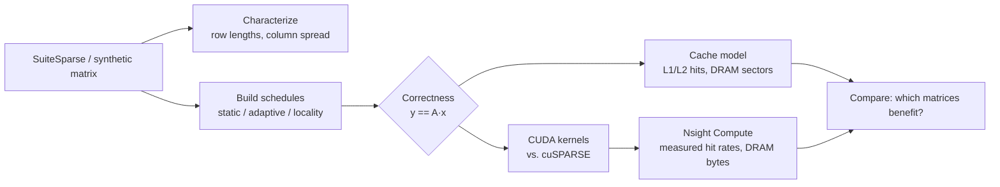

# Locality-Aware Scheduling for Memory-Efficient Sparse GPU Computation

**Reordering *which* rows a GPU processes *together* so CSR SpMV reuses the x-vector in cache instead of re-fetching it from DRAM.**


## Overview

Sparse matrix-vector multiplication (`y = A·x`) is memory-bound on GPUs. In CSR format the
matrix streams in order, but reads of `x[col]` are irregular: two rows that need the same
cache line of `x` may run on different SMs at different times, so the line is fetched twice.

This project builds and evaluates **row schedules**: permutations that decide which rows
each warp processes, without changing the matrix layout or the result. It contains:

| Component | Where | What it does |
|---|---|---|
| Scheduling policies | `spmvsched/schedule.py` | `row_static`, `adaptive_grouping`, `locality_aware`, `locality_balanced` |
| GPU memory model | `spmvsched/cachesim.py` | Trace-driven per-SM L1 + shared L2 model with warp coalescing |
| CUDA kernels | `cuda/kernels.cuh` | Scalar (thread/row) and vector (warp/row) CSR kernels with schedule indirection |
| Benchmark harness | `cuda/bench.cu` | Times every schedule vs. **cuSPARSE**, checks correctness against a CPU reference |
| Characterization | `spmvsched/analyze.py` | Row-length imbalance, column spread, schedule reuse metric |

## Research question

> Can memory locality in SpMV be exploited by *scheduling alone*, and for which matrix
> structures does the benefit outweigh the scheduling overhead?

## Approach



**Locality-aware policy.** Columns are grouped into blocks of 32 floats (one 128-byte line
of `x`). Each row gets a key from the nnz-weighted centroid and first block of its column
footprint, and rows are sorted by that key so rows reading the same lines of `x` land in the
same or neighbouring warps and thread blocks. `locality_balanced` then sorts by row length
inside small windows to reduce lane divergence while keeping most of the reuse.

**Costs that are modeled, not hidden.** A schedule adds an `order[]` load per work unit,
breaks the sequential stream of `colidx`/`values` at row boundaries, and scatters `y`
stores. The model and the benchmark count all three, so a schedule only wins if the `x`
savings exceed these costs.

See [`docs/methodology.md`](docs/methodology.md) for the model's assumptions and limits, and
[`docs/literature.md`](docs/literature.md) for related work.

## Quick start

```bash
git clone https://github.com/<your-username>/locality-aware-spmv-gpu.git
cd locality-aware-spmv-gpu
python -m venv .venv && source .venv/bin/activate     # Windows: .venv\Scripts\activate
pip install -r requirements.txt
pytest -q                                              # correctness + model sanity tests

# Cache-model study on synthetic matrices (no GPU needed, ~2 min)
python -m spmvsched.experiments --synthetic all
python -m spmvsched.plots results/sim_results.csv

# Real matrices (12month1 has very long rows; slice it for the Python model)
bash scripts/download_matrices.sh
python -m spmvsched.experiments --matrix data/12month1/12month1.mtx --max-rows 3000 \
       --out results/sim_12month1.csv
```

### On an NVIDIA GPU

```bash
make -C cuda ARCH=sm_86          # sm_75 Turing, sm_80 A100, sm_86 RTX 30xx, sm_89 RTX 40xx
bash scripts/run_gpu_bench.sh data/12month1/12month1.mtx data/pwtk/pwtk.mtx
# -> results/gpu_results.csv : schedule, kernel, avg_ms, GFLOP/s, effective GB/s, error

bash scripts/profile_ncu.sh build/12month1.csr.bin \
     locality_aware=build/12month1.locality_aware.order.bin
# -> results/ncu_metrics.csv : measured L1/L2 hit rates, DRAM bytes
```

## Results

> Numbers in this section are filled in from `results/` after running the experiments
> above. Nothing is reported here that has not been measured.

| Matrix | Kernel | Best schedule | Time vs. row_static | Time vs. cuSPARSE | DRAM bytes vs. row_static (ncu) |
|---|---|---|---|---|---|
| 12month1 | | | | | |
| pwtk | | | | | |
| webbase-1M | | | | | |

**Model vs. hardware.** Compare the modeled `x_dram_sectors` trend in
`results/sim_*.csv` with the measured `dram__bytes_read.sum` in `results/ncu_metrics.csv`.
Agreement in *direction* (which schedule wins per matrix) is the model's claim; absolute
numbers are not expected to match.

## Repository structure

```
locality-aware-spmv-gpu/
├── spmvsched/            Python package
│   ├── io.py             Matrix Market loading, synthetic matrices, .bin export
│   ├── schedule.py       Scheduling policies + correctness reference
│   ├── cachesim.py       Trace-driven GPU memory-hierarchy model
│   ├── analyze.py        Sparsity and locality characterization
│   ├── experiments.py    Model experiment runner -> CSV
│   ├── export.py         Export matrix + schedules for the CUDA harness
│   └── plots.py          Figures from result CSVs
├── cuda/
│   ├── kernels.cuh       Scalar and vector CSR kernels with schedule indirection
│   ├── bench.cu          Timing harness vs. cuSPARSE, correctness check
│   ├── csr_io.h          Binary readers
│   └── Makefile
├── scripts/              Matrix download, GPU benchmark, Nsight Compute profiling
├── tests/                pytest: permutations, exact SpMV, coalescing, cache sanity
├── docs/                 Methodology and literature notes
└── results/              Generated CSVs and figures (see results/README.md)
```

## Limitations

- The cache model is fully associative LRU at sector granularity with lockstep waves; it
  ignores conflict misses, latency, and bandwidth limits. It ranks schedules; it does not
  predict runtime.
- Schedules permute rows only. Column reordering and format changes (e.g. SELL-C-σ,
  merge-based CSR) are out of scope and would be natural comparisons.
- Matrices with more than 2³¹ nonzeros are not supported (32-bit indices).

## Context

Independent project on GPU memory-system behaviour for sparse workloads. It builds on my
research internship at NIT Trichy on CPU-FPGA streaming architectures for SpMV.

## License

MIT, see [LICENSE](LICENSE).
